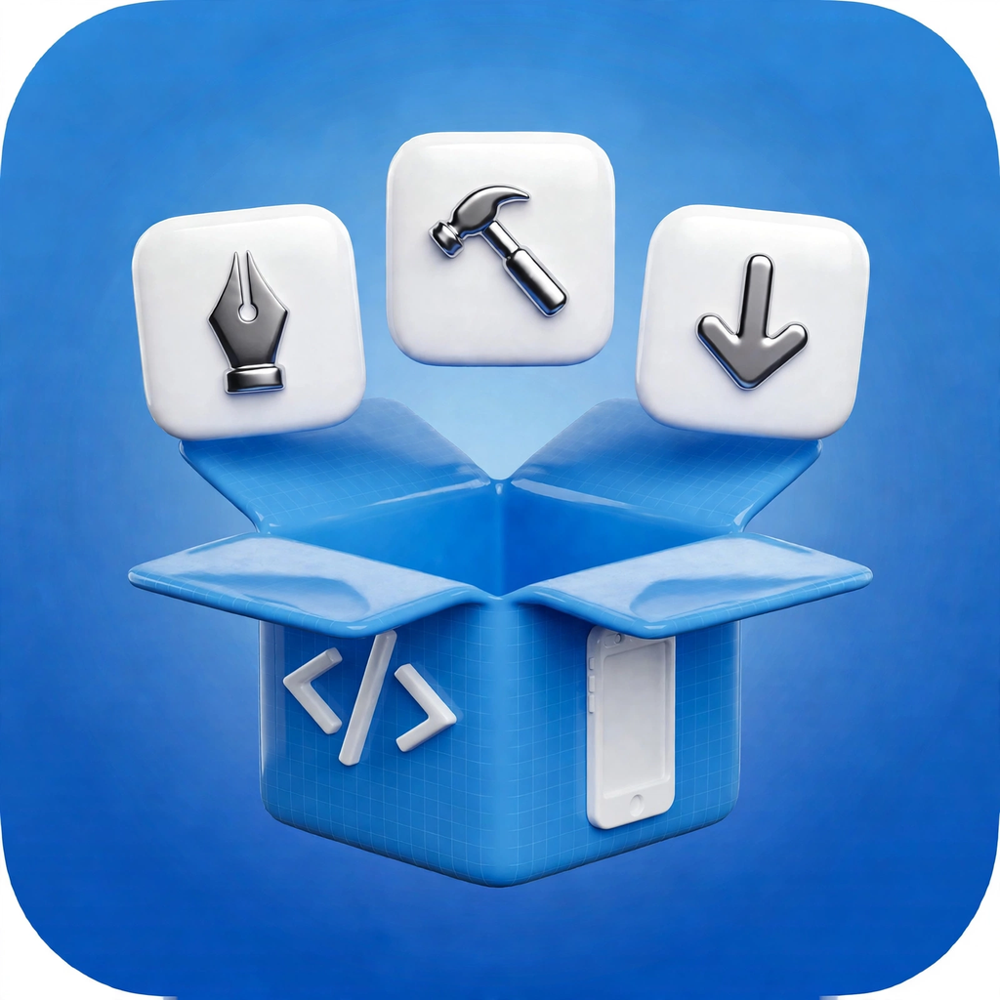
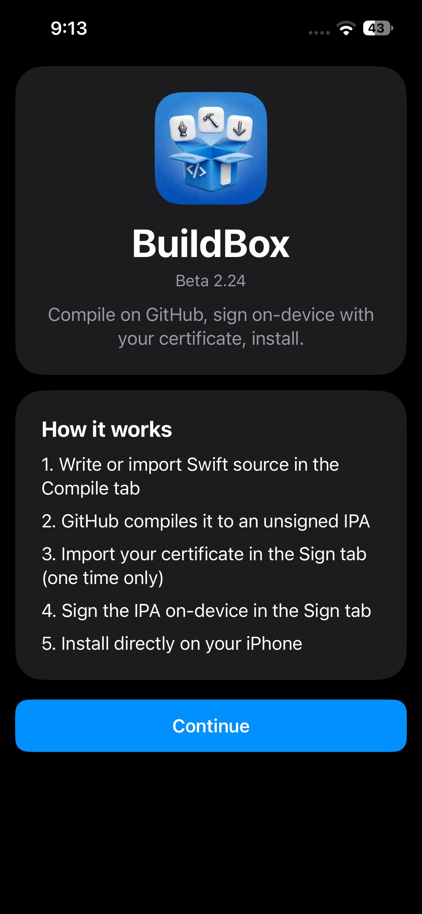
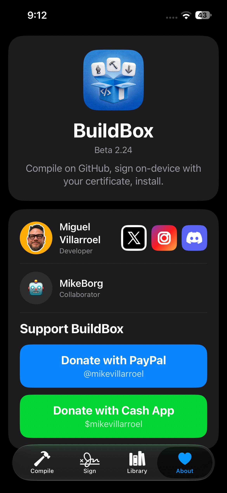
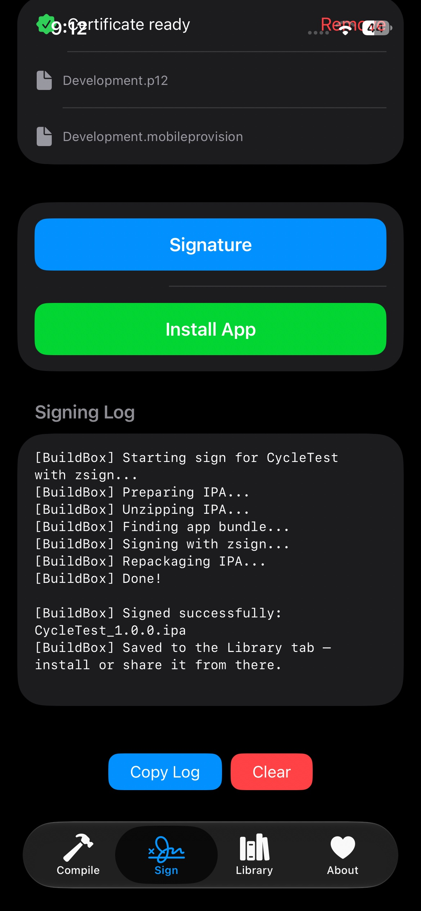
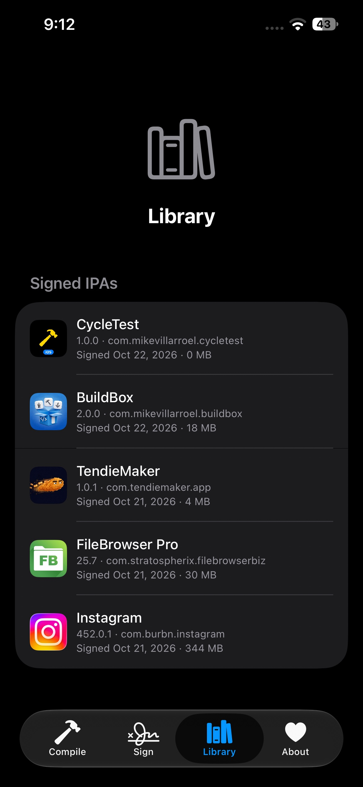
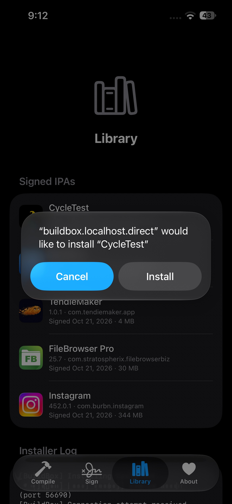
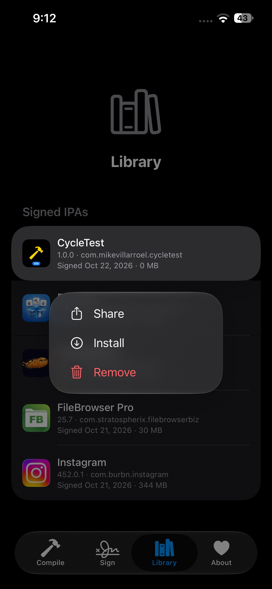
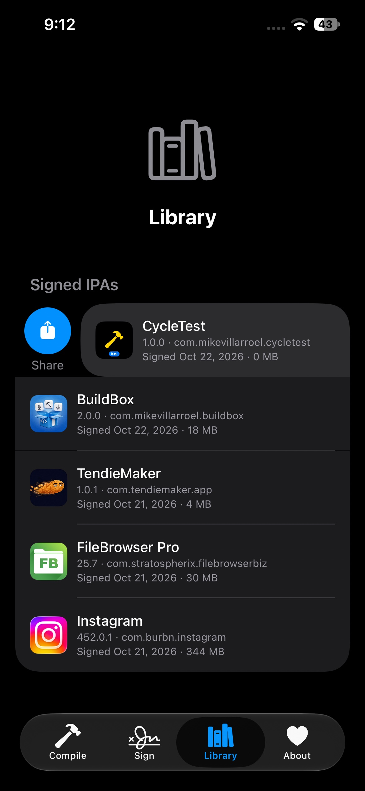
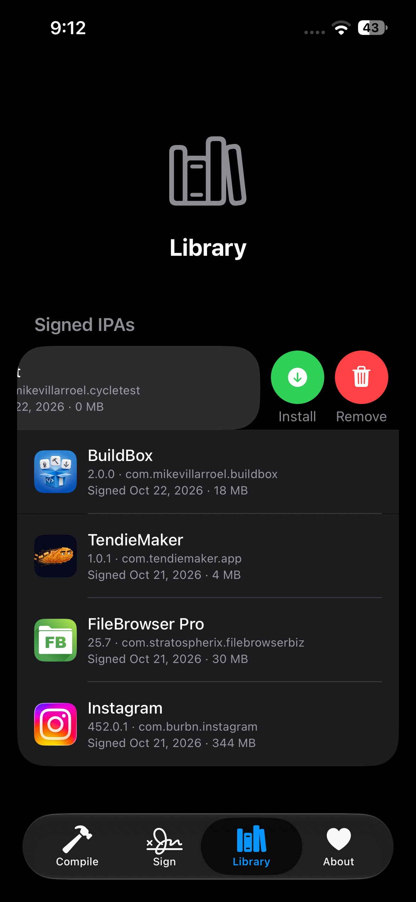

  

# BuildBox — iPhone Compiler & Signer

Compile on GitHub, sign on-device with your certificate, install. BuildBox runs the whole flow from your iPhone — no Mac, no PC, no uploading your IPAs to signing services.

## What's new in 2.0.0

- **On-device signing** — sign any IPA right on your iPhone with your own certificate (zsign, on-device). Even 300+ MB IPAs sign in about a minute.
- **On-device install** — install signed apps directly from the app over local HTTPS. No ESign, no computer.
- **Library tab** — every signed IPA lives in its own library: search, share, install or remove with a swipe.
- **Edit before you sign** — change the app name, bundle ID or version in the Sign tab.
- **Brand-new icon.**

v1.0.0 could only compile. 2.0.0 finishes the job.

## Requirements

- iPhone with iOS 17.0 or later
- **GitHub account** (free) — required for compilation. Your code goes to your own private repos; we never see it. Uses your free Actions minutes.
- Apple Developer certificate (.p12) + provisioning profile (.mobileprovision) — for signing, imported once in the Sign tab and stored on-device only.

## How it works

1. Write or import Swift source in the **Compile** tab
2. GitHub compiles it to an unsigned IPA
3. Import your certificate in the **Sign** tab (one time only)
4. Sign the IPA on-device in the **Sign** tab
5. Install directly on your iPhone

## The tabs

- **Compile** — write or import a Swift project, send it to your GitHub repo, watch the build, get the unsigned IPA back.
- **Sign** — import any IPA (yours, or one from anywhere), edit its name / bundle ID / version, sign it with your certificate.
- **Library** — your signed IPAs, kept on-device. Swipe right to share, swipe left to install or remove, long-press for the menu.
- **About** — developer info, socials, support the project.

## Install BuildBox

Download `BuildBox-2.0.0.ipa` from the [latest release](https://github.com/mikevillarroel/buildbox-ios/releases/latest). The IPA is **unsigned** — sideload it with your favorite tool (ESign, SideStore, AltStore, Feather…) using your own certificate.

## Privacy

- Your GitHub token is stored in the iOS Keychain (secure, on-device only).
- Your source code goes only to your GitHub repos. We never see it.
- Your certificate never leaves your device.
- Signed IPAs stay in the app's Library on your device.

## Screenshots

| | |
|---|---|
|  |  |
|  |  |
|  |  |
|  |  |

## Build from source

The release ships a source ZIP. Open the project in Xcode, select your team, build and run.

## Support

BuildBox is free. If it saves you time, you can support development:

- PayPal: [@mikevillarroel](https://paypal.me/mikevillarroel)
- Cash App: $mikevillarroel

Made by **Miguel Villarroel** ([@MikeBuildsApp](https://x.com/MikeBuildsApp)) with **MikeBorg** (collaborator).
Join the community: [MikeBuilds Discord](https://discord.gg/3C3fygY35E)
